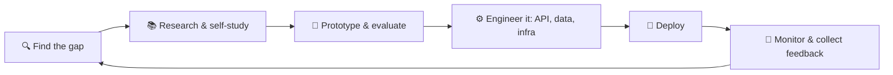

\<div align="center">

```
  ___ _   _    ___   __   _  _____   ____  ____  _   _ ___ __  __
 |_ _| \ | |  / _ \  \ \ / / / _ \ \ |  _ \|  _ \| | | |_ _|  \/  |
  | ||  \| | / /_\ \  \ V / / /_\ \ \| |_) | |_) | |_| || || |\/| |
  | || |\  | |  _  |   | |  |  _  | || _ <|  _ <|  _  || || |  | |
 |___|_| \_| |_| |_|   |_|  |_| |_|_||_| \_\_| \_\_| |_|___|_|  |_|
```

### `> AI engineer in the making. Obsessed with the gap, not the hype.`


[**GitHub**](https://github.com/inayatrahimdev) · [**LinkedIn**](https://www.linkedin.com/in/inayat-rahim-dev/) · [**Email**](mailto:inayatrahim006@gmail.com)

</div>

---

## 🖥️ `whoami`

```bash
$ whoami
inayat_rahim

$ cat mindset.txt
I don't collect buzzwords. I collect problems.
Tutorials teach you to copy. Research teaches you to question.
Most "AI projects" are a model wrapped in a notebook.
I want the part after the notebook: the API, the pipeline, the monitoring, the user.

$ cat rule_one.txt
If I can't say who it helps and how I'd measure it, I don't build it.
```

---

## 🧠 How I think (the anti-tutorial manifesto)

| ❌ The crowd | ✅ The way I work |
|---|---|
| Follow a tutorial, ship the same project as 10,000 others | Pick a real problem, then **read the research** to find what actually fits |
| "I used a Transformer" | "**Why** this model, what are its limits, and what did I try instead?" |
| Accuracy on a test set = done | Accuracy is **step one**. Deployment, drift, and trust are the real exam |
| Stack more buzzwords | Go **deep** on fewer things, then connect them |
| Learn → forget | **Self-study → build → evaluate → improve → repeat** |

---

## 🔁 My build loop



Every project has to answer: **What problem? Who benefits? What gap? How will success be measured? Can it scale? Can someone else maintain it?**

---

## 🛰️ Projects (built from problems, not templates)

### 🩺 SehatNama: AI Medical Report Analyzer
> Medical reports are dense and hard for normal people to read. This system parses them, pulls out the structure, and interprets it.

`NLP` `Medical AI` `Information Extraction`

### 🚚 AI Supply Chain Suite
> Supply chains break in ways dashboards don't warn you about. A predictive, risk-aware platform for forecasting and decision support.

`Forecasting` `Risk Analysis` `Decision Intelligence`

### 🛰️ DINOv2-SVM Satellite Classifier
> A pretrained DINOv2 Vision Transformer provides the features and an SVM classifies them. A look at how far strong representations can go without training a giant model from scratch.

`Computer Vision` `Remote Sensing` `Vision Transformers`

### 🎙️ Text & Voice Sentiment Analyzer
> Words say one thing and a voice says another. Sentiment analysis across both text and speech.

`NLP` `Speech Processing` `Audio Intelligence`

### 🎬 AI-Powered Movie Recommendation System
> Personalized suggestions, built to learn what you actually like.

`Recommender Systems` `Machine Learning` `Personalization`

### 🤖 AI Assistant App
> A Python assistant exploring conversational AI and task automation.

`LLMs` `Automation` `Assistants`

### ⚙️ AutoRepFlow
> If a human does it repeatedly, a system should do it instead. Workflow automation for killing repetitive manual work.

`Workflow Automation` `AI Workflows` `Productivity`

---

## 🧰 The stack I'm going deep on

```yaml
backend:      [Python, FastAPI, REST, Docker, PostgreSQL, Redis, Auth, API design]
architecture: [modular monolith, microservices, event-driven, queues, caching, API gateway]
data:         [SQL, data modeling, ETL/ELT, validation, feature engineering]
ai:           [ML, DL, CV, NLP, speech, Transformers, LLMs, VLMs, RAG, agents,
               fine-tuning, embeddings, evaluation, inference optimization]
genai:        [diffusion, VAEs, GANs, flow matching, state space models, multimodal]
mlops:        [experiment tracking, model versioning, CI/CD for ML, monitoring, evaluation]
```

---

## 🎯 What I'm building toward

- 🏗️ Scalable AI systems, not just models
- 🔌 Production-ready backends that serve those models
- 🔄 Data pipelines that don't silently break
- 📊 Deployed AI that is monitored, evaluated, and improved
- 💼 Business problems translated into engineering solutions
- 📈 Systems with **measurable** value, not vibes

---

## 📡 Let's connect

Got a hard problem, a gap nobody has fixed, or something worth building? Reach out.

| | |
|---|---|
| 🐙 GitHub | [inayatrahimdev](https://github.com/inayatrahimdev) |
| 💼 LinkedIn | [Inayat Rahim](https://www.linkedin.com/in/inayat-rahim-b0655b29b/) |
| ✉️ Email | inayatrahim006@gmail.com |

<div align="center">

```
> status: learning, building, shipping.
> next: whatever problem is worth solving.
```

</div>
