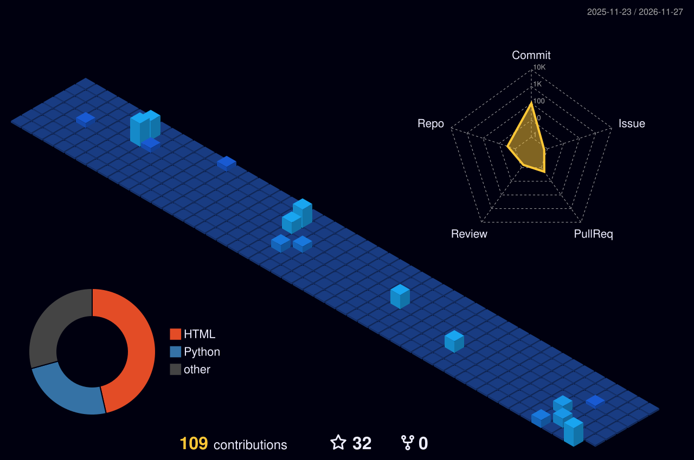
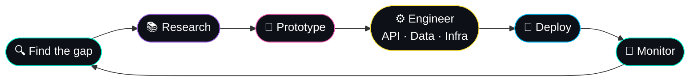

<div align="center">

<a href="https://github.com/inayatrahimdev">
  
</a>

<br/>

<a href="https://github.com/inayatrahimdev"></a>
<a href="https://www.linkedin.com/in/inayat-rahim-b0655b29b/"></a>
<a href="mailto:inayatrahim006@gmail.com"></a>


</div>

---

## ⚡ `> whoami`

```python
class InayatRahim:
    role      = "AI Engineering Student"
    obsession = "the gap between a model and a product"
    method    = ["research", "self-study", "build", "evaluate", "improve"]
    refuses   = ["tutorial clones", "buzzword collecting", "notebook-only projects"]

    def mission(self):
        return "AI should create value, not just predictions."
```

> Most AI projects stop at the notebook. I care about what comes **after**: the API, the pipeline, the deployment, the monitoring, and the person using it.

---

## 🧊

<div align="center">
  
</div>

---

## 🧬 How I Build



Every project must answer: **What problem? Who benefits? What gap? How is success measured? Can it scale? Can it be maintained?**

---

## 🚀 Featured Projects

<table>
<tr>
<td width="50%" valign="top">

### 🩺 SehatNama
**AI Medical Report Analyzer**
Parses, analyzes, and interprets medical reports.


</td>
<td width="50%" valign="top">

### 🚚 AI Supply Chain Suite
Predictive, risk-aware analytics and decision support.


</td>
</tr>
<tr>
<td width="50%" valign="top">

### 🛰️ DINOv2-SVM Satellite Classifier
Pretrained DINOv2 Vision Transformer features + SVM classifier for satellite imagery.


</td>
<td width="50%" valign="top">

### 🎙️ Text & Voice Sentiment Analyzer
Sentiment analysis across both text and speech.


</td>
</tr>
<tr>
<td width="50%" valign="top">

### 🎬 AI Movie Recommendation System
Personalized movie suggestions.


</td>
<td width="50%" valign="top">

### 🤖 AI Assistant App
Python assistant exploring conversational AI and task automation.


</td>
</tr>
<tr>
<td colspan="2" valign="top">

### ⚙️ AutoRepFlow
Workflow automation that removes repetitive manual work.


</td>
</tr>
</table>

---

## 🛠️ Tech Arsenal

<div align="center">

**Core**


**AI / ML**


</div>

| Layer | What I'm going deep on |
|---|---|
| ⚙️ **Backend** | FastAPI · REST · Auth · API Design · PostgreSQL · Redis · Docker |
| 🏗️ **Architecture** | Modular Monolith · Microservices · Event-Driven · Queues · Caching · API Gateway |
| 🗄️ **Data** | SQL · Data Modeling · ETL/ELT · Validation · Feature Engineering |
| 🧠 **AI** | ML · DL · CV · NLP · Speech · Transformers · LLMs · VLMs · RAG · Agents · Fine-Tuning · Embeddings · Evaluation · Inference Optimization |
| 🎨 **GenAI** | Diffusion · VAEs · GANs · Flow Matching · State Space Models · Multimodal |
| 🔄 **MLOps** | Experiment Tracking · Model Versioning · CI/CD for ML · Monitoring · Evaluation |

---

## 📊 Stats

<div align="center">
  
  
  <br/>
  
</div>

---

## 🎯 Where I'm Headed

- 🏗️ Scalable AI systems, not just models
- 🔌 Production-ready backends that serve them
- 🔄 Data pipelines that don't silently break
- 📊 Deployed AI that is monitored, evaluated, and improved
- 💼 Business problems turned into engineering solutions

---

## 📡 Let's Build Something

Got a hard problem or a gap nobody has fixed? Reach out.

<div align="center">

[](https://github.com/inayatrahimdev)
[](https://www.linkedin.com/in/inayat-rahim-b0655b29b/)
[](mailto:inayatrahim006@gmail.com)

</div>


